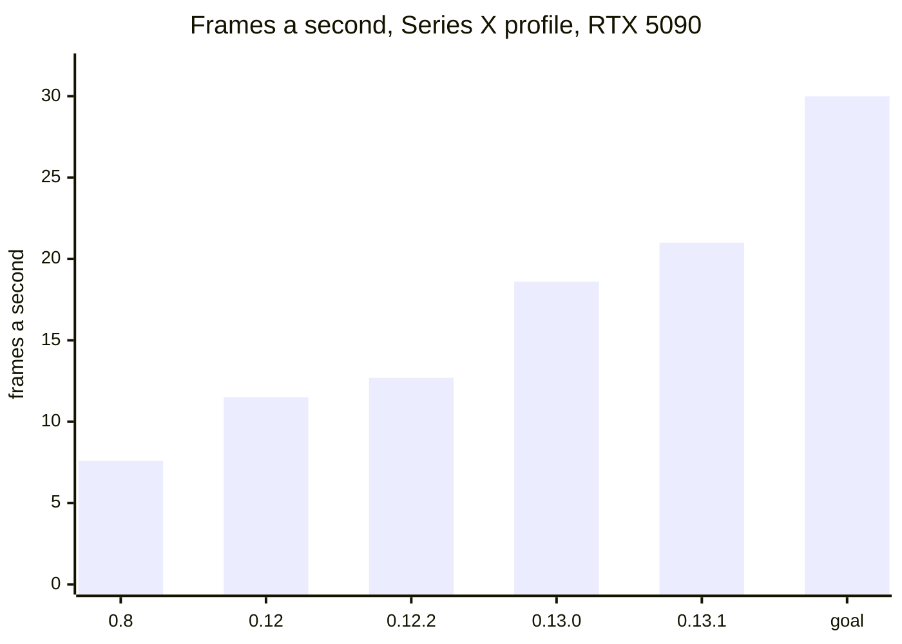

<h1 align="center">PiloteBox</h1>

<p align="center">
  <b>An Xbox Series (Scarlett) compatibility layer for Windows, tuned for NVIDIA cards.</b><br>
  The title's own x64 code runs natively. Its Direct3D 12 and its RDNA2 shaders are translated for your card.
</p>

<p align="center">
  <a href="https://github.com/PiloteCode/PiloteBox/actions/workflows/ci.yml"></a>
  <a href="https://github.com/PiloteCode/PiloteBox/releases/latest"></a>
  
  
  
  
  
</p>

<p align="center">
  <a href="#the-road-to-30-frames-a-second">Progress</a> ·
  <a href="#where-it-stands-2026-11-27-version-0131">Status</a> ·
  <a href="#quick-start">Quick start</a> ·
  <a href="#benchmarks-measuring-and-reporting">Benchmarks</a> ·
  <a href="ROADMAP.md">Roadmap</a> ·
  <a href="CHANGELOG.md">Changelog</a> ·
  <a href="CREDITS.md">Credits</a>
</p>

PiloteBox runs an Xbox Series title's own x64 code natively on a Windows PC. It
is not an emulator of the processor: the title's code runs as it is. What
PiloteBox supplies is everything around it: a loader for the title's image, the
console's GDK runtime (`XGameRuntime`, memory, files, DirectStorage, input,
audio) on Win32, the console's Direct3D 12 (`d3d12_xs`) on the PC's Direct3D 12,
and a recompiler that turns the console's RDNA2 (GFX10) shaders into DXIL.

Its own subject is the cards the console's shaders were not written for: GPUs
with 32-lane waves (NVIDIA, Intel) and a view heap capped at 1,000,000
descriptors. The goal is plain: **the Series X profile, at full quality, at a
steady 30 frames a second.** It is not there yet; the numbers below say where
it is.

> **This repository contains no game files, code, keys or assets.** You need
> your own lawful copy of the title you run. PiloteBox is not affiliated with
> or endorsed by any console maker, developer or publisher. We do not help
> anyone obtain a game: requests for game files, keys, dumps or links are
> closed without an answer.

## The road to 30 frames a second

One reference scene (a prologue's first playable scene, about 4,850 draws a
frame), the Series X profile at full quality, one machine: a GeForce RTX 5090
and a Core i9-14900KF. Each block is one frame a second.

| Version | Date | What moved it | A frame | Frames a second |
|---|---|---|---|---|
| 0.8 | 25 Nov | the first layer on an NVIDIA card | 132 ms ¹ | `████████░░░░░░░░░░░░░░░░░░░░░░` 7.6 |
| 0.12 | 27 Nov | a new layer: list calls written down and translated by threads; our translator for 32-lane cards | 79 to 95 ms ¹ | `████████████░░░░░░░░░░░░░░░░░░` 11.5 |
| 0.12.2 | 27 Nov | the same, measured as the rows below | 77.9 and 79.6 ms | `█████████████░░░░░░░░░░░░░░░░░` 12.7 |
| 0.13.0 | 27 Nov | host copies of title buffers and windows of title memory in the card's memory | 53.7 and 53.8 ms | `███████████████████░░░░░░░░░░░` 18.6 |
| **0.13.1** | 27 Nov | first cuts on the one thread that sets the frame | **46.6 and 48.8 ms** | `█████████████████████░░░░░░░░░` 21.0 |
| the goal |  | two submissions prepared at once, then the card's indirect executions | 33.3 ms | `██████████████████████████████` 30.0 |

¹ Measured with a capture of one frame in eight for pictures, which costs
about 9 ms a frame on the thread that sets the frame. The rows without the
mark are without captures: two runs of four minutes, alternated with the
version before, the median frame of each run's last minute.



**What each step taught us:**

- **0.12 to 0.13.0: it was the bus, not the shaders.** Half of the card's
  time went to shaders reading the PC's memory across PCIe. With the host
  copies of title buffers and the windows of title memory in the card's own
  memory, the card's work by command fell from 53.8 to 26.6 ms a frame.
- **0.13.0 to 0.13.1: one thread sets the frame.** The card now waits for us.
  The thread that prepares the title's submissions works 44 ms of a 47 ms
  frame; its planning went from 10 ms to 3.8 ms.
- **Next: under 29 ms on that thread**, by preparing two submissions at once.
  The [roadmap](ROADMAP.md) has the plan and what is measured so far.

Every figure here is measured on our machine and says how. Yours will differ:
run `pilotebox bench` and add your line to the
[benchmarks issue](https://github.com/PiloteCode/PiloteBox/issues/12).

## Where it stands (2026-11-27, version 0.13.1)

Measured on one machine: Windows 11, GeForce RTX 5090 on a PCIe 5.0 x16 link,
Core i9-14900KF, 128 GB of RAM, a 2560x1440 display, a diagnostics build, one
Xbox Series title, automated runs of four to five minutes that start a new game
or load a save.

| Step | State |
|---|---|
| Loads and boots | yes |
| Menus, videos, loading screens | yes, 30 fps |
| In the world | yes |
| Playable | yes: a new game's opening and the prologue |
| Series X profile (full quality) | **21.5 and 20.5 frames a second** (46.6 and 48.8 ms a frame) in the reference scene. Not 30 yet. Two runs of four minutes, alternated with 0.13.0 (53.7 and 53.8 ms), the median frame of each run's last minute, the process at high priority, no captures, another program drawing on the card |
| The card's work (Series X) | 53.8 ms a frame by command with the placement of before, 26.6 ms with every title buffer and the windows on the card's side |
| Series S profile (lighter, upscaled) | shows a picture since 0.12.2; 60.6 ms a frame (16.5 fps) in 0.13.0, one run in the same scene with captures on (about 9 ms a frame of that run): the same thread of the processor's side bounds it |
| Ray-traced indirect light (`--rt`) | runs, far too slow to play with today |
| Stability | no crash and no device loss in eleven automated runs of this version; long sessions are not measured yet |
| Memory | about 37 GB of private memory and 11-19 GB of video memory: 64 GB of RAM recommended |
| Shaders | 25,953 of the 25,953 programs of the title's shader archive translate and validate for 32-lane GPUs |
| Tests | more than 1,100 run on every push, the layer's and the translator's on the software adapter; the translator's whole suite also passes on the card (390 tests on an RTX 5090) |

**What bounds the frame now is the processor's side.** The card's work was
halved by where title buffers live: with every title buffer's copy and the
windows of title memory on the card's side, the card's work by command fell
from 53.8 to 26.6 ms a frame (dispatches 29.9 to 7.5 ms). The card now waits
for us more than 10 ms a frame. One thread of ours, the one that prepares the
title's submissions and sends them, works 43.6 and 45.5 ms of the frame: it
sets the frame, and the title's threads wait at the present for it.

The one settle a frame has its cause and its answer. A 240-byte copy at its
place in a list is read as constants by a draw of the same list;
`VICTORY_FILL_FORWARD` (on) answers it. Its wait is now 1.2 to 1.5 ms a frame,
where it was 38.7 ms in 0.12.2. Loops are not the card's time either: of 746
programs drawn with counted loops, one pixel program reaches its limit.

The [roadmap](#roadmap) says what we do next.

Known to be wrong:

- Textures of what just came into view appear late: skin and clothes can stay
  grey for seconds.
- Rooms with little direct light are too dark without `--rt`.
- The first run after a build or a driver update stutters while the driver
  makes its pipelines.

## Quick start

You need Windows 10 or 11 (x64), a processor with AVX2, a Direct3D 12 card with
shader model 6.6 and mesh shaders, [Rust](https://rustup.rs) (the toolchain is
pinned in `rust-toolchain.toml`), the MSVC build tools with a Windows SDK, and
your own copy of the title, in a folder outside this repository.

```powershell
git clone https://github.com/PiloteCode/PiloteBox
cd PiloteBox
cargo build --release -p victory                             # makes target\release\pilotebox.exe
target\release\pilotebox.exe setup --game D:\titles\mine     # once: remembers the folder, checks the PC, translates the shaders
target\release\pilotebox.exe play
```

Or double-click `PiloteBox.cmd`: it builds when the sources changed, then
plays. `pilotebox` alone says where things stand: the title found or not, the
mode, the cache, the last run and the last benchmark.

Without `--game`, the title is looked for in `PILOTEBOX_GAME_DIR`, then in
`pilotebox.toml` (which `setup` writes), then beside the program and in the
folder above the repository.

## Commands

| Command | What it does |
|---|---|
| `pilotebox setup` | The first run in one command: finds the title or takes `--game`, writes `pilotebox.toml`, runs `doctor`, translates the shaders ahead. |
| `pilotebox play` | Plays the title. `--mode x` is the Series X profile (the default), `--mode s` the Series S profile, `--rt` turns the ray-tracing structure builder on, `--safe` leaves the newest speed-ups out (the first thing to try when something is wrong). |
| `pilotebox bench` | A timed run that ends by itself (`--seconds 300` by default) on a **copy** of your saves, then its figures: time to the world, mean and worst frame, preparing, card, copy-back, draws, dropped draws. Written as Markdown, JSON and a log beside the cache folder; its last line is a one-line summary made for pasting. |
| `pilotebox doctor` | Checks this PC: card and driver, wave size, view heap, PCIe link, AVX2, memory, disk, the cache's parts, the title's files, other runs. |
| `pilotebox check` | `doctor`, then a short `bench`, ending with PASS or FAIL. |
| `pilotebox clean` | Lists what in the cache folder is old and removes it with `--yes`. It never touches saves. |
| `pilotebox report` | Writes one text file for a bug report: `doctor`, the last run, the last benchmark, the ends of the logs, with user names and the title's folder taken out. |
| `pilotebox migrate` | Moves an older installation's folders (`%LOCALAPPDATA%\victory`) to `%LOCALAPPDATA%\PiloteBox`. Saves are copied and checked, never removed; it only lists until `--yes`. |

The developer commands of the layer are all still there: `run`, `shaders`,
`warm`, `translate`, `translate-diff`, `shader-info`, `replay`, `inspect`,
`census`, `config`. `pilotebox <command> --help` describes each, and `doctor`,
`bench` and `check` take `--json`.

```powershell
pilotebox bench --name first                    # five minutes, Series X profile
pilotebox bench --mode s --seconds 180          # three minutes, Series S profile
pilotebox check                                 # is this build and this PC all right?
```

## Modes

| Mode | What you get | What it costs |
|---|---|---|
| `--mode x` (default) | The Series X profile: the title's full quality. | 68.0 ms a frame (14.7 fps) on an RTX 5090 in the prologue's first playable scene. |
| `--mode s` | The Series S profile: a 960x540 scene upscaled by the title's own upscaler. Softer, and much lighter on the card. | 60.6 ms a frame (16.5 fps) in 0.13.0, one run; the fast mode while the Series X profile is brought to 30 fps. |
| `--rt` | The title's ray-traced indirect light: the structure builder and the walks. | With the walks really running, a tester measured 333-425 ms a frame on an RTX 4070 SUPER. For looking, not for playing. |
| `--safe` | The layer's older, slower ways. | Slower; use it to tell a bug of the speed-ups from a bug of the layer. |

Every switch of the layer can be written `PILOTEBOX_<NAME>` (the upstream
spelling `VICTORY_<NAME>` still works); the play settings are the defaults, so
none is needed. The switches are described in
[docs/findings.md](docs/findings.md), [docs/README-fxceless.md](docs/README-fxceless.md)
and each module's notes.

### Switches that bear on the card's time and on the settle

The play settings are the defaults; these are the ones that matter most for
the goal, with what they are by default:

| Switch | Default | What it does |
|---|---|---|
| `VICTORY_CARD_SIDE` | on with NVIDIA cards, else off | Every title buffer's copy and the windows of title memory on the card's side (the windows through the bus where the card's memory can be mapped, two-sided copies elsewhere), up to totals by the card's budget (the 8 and 12 GB sizes are guesses still to be measured), their room kept by the texture queue; each buffer's own switch still wins. `=0`: the placement of before; `=1` on other cards (not measured there). The card's work by command: 53.8 ms a frame without it, 26.6 ms with it; the frame 89.2 ms without it, 68.0 ms with it. |
| `VICTORY_FILL_FORWARD` | on | A fill of upload memory that reads only what a copy at its place in the same list just wrote reads the copy's source instead, on the card (the cause of the one settle a frame). `=0`: it waits for the flights, as before. |
| `VICTORY_CARD_DIRTY_FLAGS` | on | Copies in the card's memory with nothing to go up are passed over by a shared flag. `=0`: each is asked, as before. |
| `VICTORY_LAND_ASIDE=1` | off | The thread that sends submissions leaves the lists that have run to a helper thread. Measured inside the spread (58.7 against 61.0 ms a frame). |
| `VICTORY_THREAD_TICKET` | on | Console threads of two-dimensional compute groups are each given once (host waves of such a group are not consecutive on NVIDIA). `=0`: the flat thread number rounded, as before. |
| `VICTORY_BPERMUTE_HALVES` | on | A wave64 backward permute reads within each 32-lane half, as the console does. `=0`: across all 64 lanes. |
| `VICTORY_PORT_RT=1` | off | When a fill of upload memory reads bytes that a copy at its place declared written, the card brings them, or the fill takes them from the copy's source, instead of the submission waiting for every flight (the one settle a frame). Its frame line counts the cases even when off. |
| `VICTORY_PORT_CONSTANTS=1` | off | The title's 174 MB constants heap is read by the card where the title writes it: no uploads and no fills of it. With it, indirect executions whose arguments sit there are prepared alone right before they run (`VICTORY_PORT_CONSTANTS_ORDER`, on; 2-5 ms). |
| `VICTORY_FILL_TITLE=2` | off | Small fills of upload memory go on without waiting for flights where no shader wrote the page lately. |
| `VICTORY_RT_STAMPS=1` | off | Diagnostics builds: the card's time of every compute dispatch, by kind and by pipeline. |
| `VICTORY_PORT_DESCRIPTORS=1`, `VICTORY_PORT_GUARD=1`, `VICTORY_PORT_JOURNAL=1` | off | The layer's renderer ports 2, 6 and 7: less work on the processor (descriptor stores reported by the title's own code, a shared guard lock, the heaps' records split). |
| `VICTORY_TEXTURE_MAX` | 0 | Streamed textures at their full size (the layer underneath caps them at 1,024 texels a side for 16 GB cards). |
| `VICTORY_RESIDENCY`, `VICTORY_FALLBACK_HEAPS`, `VICTORY_SWEEP_PER_HEAP`, `VICTORY_XMA_REFILL` | 1 | codec-d/cool_fox's memory budgets, heaps of one slot, the heap buffer pass per heap and XMA refill, as on an RTX 5090 before. |
| `VICTORY_DSTORAGE_STAGING_MB` | 256 | A DirectStorage staging floor (cool_fox). |
| `VICTORY_CARD_BUFFERS_MIN_KB`, `VICTORY_CARD_BUFFERS_MB`, `VICTORY_CARD_WINDOWS_MB`, `VICTORY_CARD_RESERVE_BUDGETS=1` | unset | Title buffers from that size up, and the windows shaders read, kept on the card within those budgets; with the last one, textures leave the room (TaynanGT's tree's RTX 4070 preset: 64, 1536, 1024, 1). |
| `VICTORY_STRUCTURED_RAW=1` | 0 | Structured views off 16 bytes get a copy of their own bytes. Off: on cards whose heaps have no raw twins (NVIDIA) the rule made 400 copies a frame under one lock and doubled the frame's time. |

Renderer port 5 (`VICTORY_PORT_CBV`) needs the layer underneath's own
translator and does nothing with ours. `VICTORY_FSR_4K=quality` (Series X
profile only, with AMD's signed `amd_fidelityfx_upscaler_dx12.dll` in
`VICTORY_FIDELITYFX_DIR`) renders at 2560x1440 and upscales to 3840x2160 with
FSR 4.1.2; it is not measured on NVIDIA yet.

## What is different here

- **A shader translator for 32-lane GPUs.** Every one of the 25,953 programs
  of the title's shader archive translates and validates for a host whose
  widest wave is 32 lanes: paired, split, halves and local forms of the
  console's 64-lane programs, geometry programs as geometry shaders, mesh
  programs linked with their pixel programs, dispatches by thread counts.
- **The upscaler's own shader containers** (an `ACCC` part holding an `FSPX`
  blob) translate too, so the Series S profile shows a picture (0.12.2).
- **16-bit typed buffers moved as integers** where a program moves halves
  through unsigned views: on NVIDIA the float path read zeros (0.12.1).
- **Dynamic descriptor slots that do not run out** on a 1,000,000-view heap:
  a submission gives its tables' slots back when the card has run it (from
  codec-d/cool_fox, see [CREDITS.md](CREDITS.md)).
- **The play settings are the defaults**: no script and no environment
  variable to remember.
- **Builds for x86-64-v3** with thin LTO: the title needs AVX2 anyway.
- **The PiloteBox commands**: `play`, `bench`, `doctor`, `check`, `clean`, and
  a benchmark anyone can repeat and paste.
- **A frame recorder and replay** (from the layer underneath) that we use to
  time shader forms against each other without the title.

## How it works, in one paragraph

The loader maps the title's PE image at an address of its own and patches the
few instructions a PC processor lacks. The runtime answers the console's GDK
calls (`XGameRuntime`, `XMemAllocate`, `XTaskQueue`, `GameInput`, DirectStorage,
XMA audio) with Win32 services. The graphics layer takes the console's
`d3d12_xs` command lists, written down on the title's threads and translated by
threads of ours, keeps host copies of the title's buffers and textures coherent
with what shaders write (guard pages, a write watch, copies in the card's
memory, a relay that brings shader writes back), and sends host lists to
Direct3D 12 without waiting for the card. The shader recompiler lowers GFX10
(RDNA2) machine code to DXIL: wave operations, LDS memory, typed and raw
buffers, images, mesh and geometry stages, ray-tracing structure walks. See
[docs/architecture.md](docs/architecture.md).

## Tests

Every push and every pull request runs these on GitHub's Windows runners
(`.github/workflows/ci.yml`; the same commands are in CONTRIBUTING.md):

- the asset policy and the names check: `cargo run -p xtask -- policy`;
- the release build, and clippy on the packages that are clean;
- the tests of the packages that need no graphics adapter, and the runtime's:
  `cargo test -p victory-hle -- --test-threads=1`;
- the translator's and the layer's tests on the software adapter (WARP):
  `VICTORY_WARP=1 cargo test -p victory-shader -- --test-threads=1` and
  `VICTORY_D3D12_WARP=1 cargo test -p victory-gpu --features diagnostics -- --test-threads=1`.

That is more than 1,100 tests. Eleven are skipped by name on the software
adapter: nine because of the adapter (it orders signed zeros its own way, has
waves of four lanes, refuses one pipeline and does not reject pixels outside
the depth bounds), two of ours that still assume a default that changed. On a
card the translator's whole suite passes (390 tests on an RTX 5090, 0.13.1).

## Benchmarks: measuring and reporting

`pilotebox bench` is the measure we use and ask for. It reads the layer's own
frame lines, leaves out the seconds in which pipelines are still being made,
and reports means over the world (1,000 draws a frame or more).

When you report a number, give the card, the profile, the scene and the
build, and say what was not tested. One run on a quiet machine: a build running
beside the title doubles the preparing time. A report template is in the issue
tracker.

## Roadmap

The goal is the Series X profile at a steady 30 fps on NVIDIA cards: the
card's work and the processor's side each under 33 ms a frame.

Done in 0.13.0:
- **The card's work, halved by placement.** It went from 53.8 to 26.6 ms a
  frame with every title buffer and the windows of title memory on the
  card's side (`VICTORY_CARD_SIDE`, now the default on NVIDIA cards); the
  frame from 89.2 to 68.0 ms (14.7 fps).
- **The one settle a frame: its cause found.** A 240-byte copy at its place
  in a list is read as constants by a draw of the same list.
  `VICTORY_FILL_FORWARD` (on) answers it.
- **Loops answered.** Of the 746 programs drawn with counted loops, one pixel
  program reaches its limit.

Next:
1. **The processor's side**, now the bound: the one thread of ours that
   prepares the title's submissions and sends them works 43.6 and 45.5 ms a
   frame, and the frame is that plus about 4 ms. Next: the first half of the
   next submission prepared on a second thread while this one's steps run.
2. **The placement on other cards**: the 8 and 12 GB sizes measured, and the
   placement tried on AMD and Intel cards.
3. **The console's 64-lane programs on 32 lanes**: their forms measured
   against each other, and a wave64 `ds_bpermute` within each half.
4. **The Series S profile** as the fast mode meanwhile, with PC upscaling and
   frame generation from TaynanGT's tree (the libraries are the user's).
5. **The ray-traced light** once the rest fits in a frame.

[ROADMAP.md](ROADMAP.md) has each track with its figures.

## Troubleshooting

- **Stutter in the first minutes:** the driver is making pipelines. A second
  run is smooth; `pilotebox shaders` and `pilotebox warm` make them ahead.
- **Everything is several times slower than it was:** look at the PCIe line of
  `pilotebox doctor`. After a driver reset a card can fall back to
  generation 1 until the PC is restarted.
- **A build fails with "no space left":** build folders are large (10 GB a
  tree). `pilotebox clean` only looks at the cache; `cargo clean` frees the
  build folder.
- **Something is wrong in the picture:** try `pilotebox play --safe`, then
  open an issue with the output of `pilotebox doctor` and the log lines.
- **Your saves:** `bench` and `check` run on a copy. `play` uses the data
  folder (`%LOCALAPPDATA%\PiloteBox\data`, or an older installation's
  `%LOCALAPPDATA%\victory\data` until `pilotebox migrate`); copy it before
  trying a new version.

## Contributing

Pull requests are welcome and are checked on every push: the asset policy, the
build, the lints and the tests on the software adapter. Read
[CONTRIBUTING.md](CONTRIBUTING.md) first; it is short. We aim to answer within
a day. What changed in each version is in [CHANGELOG.md](CHANGELOG.md); where
this is going, track by track, in [ROADMAP.md](ROADMAP.md).

## Credits

PiloteBox stands on other people's work, named exactly in
[CREDITS.md](CREDITS.md): VIctory by Marvisak and its contributors,
fxceless/victory-fork, avatarmanz/VIctory-7900XTX (the layer this tree is built
on), codec-d/cool_fox, and the people whose pull requests those trees carry.

Internal names (crates, modules, the switches as the layer reads them) stay
upstream's on purpose: those trees are merged here regularly, and renaming
their insides would turn every merge into conflicts.

## License

GPL-3.0-or-later, as VIctory. See [LICENSE](LICENSE); the one file that is not
covered is named in [docs/asset-policy.md](docs/asset-policy.md).
